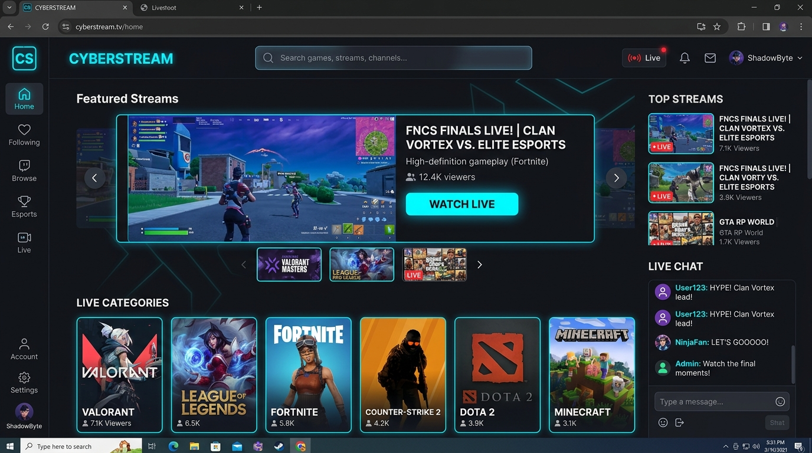
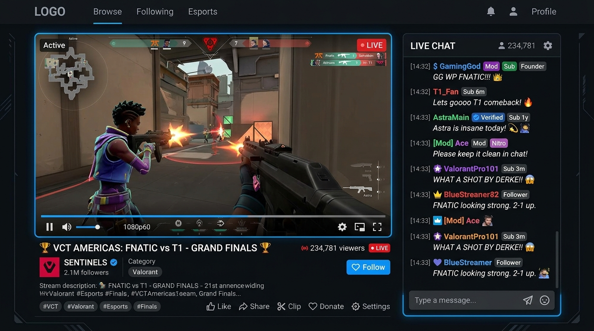
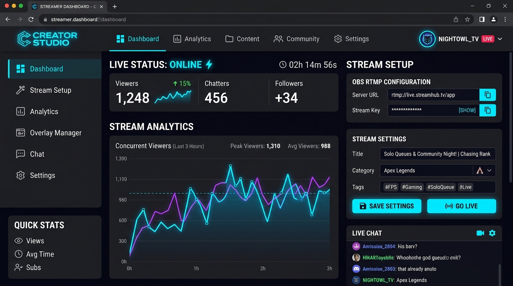

<div align="center">

# ⚡ AuraCast

**Next-Generation Self-Hosted Livestreaming Platform**  
*Maximum Freedom. Zero Platform Cuts. Built for Streamers and Communities.*

[](https://www.gnu.org/licenses/agpl-3.0)
[](https://nodejs.org/)
[](https://www.typescriptlang.org/)
[](https://www.docker.com/)
[](https://react.dev/)
[](https://tailwindcss.com/)
[](https://socket.io/)

[🇵🇱 Przeczytaj ten dokument w języku polskim (README.pl.md)](README.pl.md)

</div>

---

## 🌟 Overview

**AuraCast** is a modern, high-performance, open-source live-streaming platform engineered from the ground up to give content creators 100% sovereignty over their broadcasts and revenue.

Unlike commercial monopolies like Twitch and Kick that siphon 30%–50% of creator earnings, enforce arbitrary censorship, and lock down proprietary ecosystems, AuraCast provides an entirely self-hostable, esports-grade streaming suite with direct peer-to-peer monetization (BYOM).

---

## 📸 Platform Preview

| Overview & Featured Carousel | Live Video Player & WebSocket Chat |
| :---: | :---: |
|  |  |

<div align="center">

| Creator Studio & OBS Configuration |
| :---: |
|  |

</div>

---

## ✨ Key Capabilities

- 🎥 **Ultra-Low Latency RTMP Ingestion:** Direct broadcasting support via OBS Studio, Streamlabs, or vMix through the integrated RTMP ingest engine on port 1935, delivered over HTTP-FLV.
- 💬 **Real-Time WebSocket Chat:** Blazing-fast community chat powered by Socket.io rooms per channel, with verified badges, role hierarchy, custom username colors, and rich emote support (`Kappa`, `LUL`, `PogChamp`, `KEKW`, `catJAM`, `monkaS`, `RushB`).
- 💸 **BYOM (Bring Your Own Monetization):** 0% platform cuts, zero predatory subscription tiers. Creators link directly to Ko-fi, Patreon, Tiply, or crypto wallets, keeping 100% of their earnings.
- 🎨 **Esports Electric Blue Design System:** High-energy, dark-mode gaming aesthetics crafted with Tailwind CSS v4, custom glassmorphism overlays, responsive video player controls, and collapsible sidebars.
- 🛡️ **Full Self-Hosted Independence:** Own your data, your viewer logs, and your user accounts with zero vendor lock-in.

---

## 🏗️ Architecture Stack

- **Frontend:** React 19, TypeScript, Vite 8, Tailwind CSS v4, Socket.io Client, flv.js, Lucide Icons, Zustand.
- **Backend:** Node.js 20, Express, TypeScript (`tsx`), Socket.io Server, NodeMediaServer (RTMP / HTTP-FLV), MySQL2 (Connection Pooling), JWT, bcrypt.
- **Database:** MySQL 8.0 relational schema with automated initialization.
- **Deployment:** Docker & Docker Compose with multi-stage container builds and Nginx reverse proxy.

---

## 🚀 Quick Start (Docker - Recommended)

The fastest and most robust way to deploy AuraCast locally or in production is using Docker Compose.

### 1. Clone the repository
```bash
git clone https://github.com/your-username/AuraCast.git
cd AuraCast
```

### 2. Configure Environment Variables
Copy the root `.env.example` template:
```bash
cp .env.example .env
```

### 3. Launch with Docker Compose
```bash
docker compose up -d --build
```

That's it! Docker will automatically:
1. Spin up **MySQL 8.0** and execute database migrations from `database/schema.sql`.
2. Compile and launch the **Backend API & RTMP Media Server** (ports `4000`, `1935`, `8000`).
3. Build and serve the **React Frontend** via Nginx (ports `80` and `5173`).

Open **http://localhost:5173** (or your server's domain/IP) in your browser.

---

## 💻 Manual Setup (Development Mode)

If you are developing locally without Docker, follow these instructions:

### Prerequisites
- **Node.js:** v20.0.0 or higher
- **npm:** v10.0.0 or higher
- **MySQL:** v8.0 running locally

### 1. Database Setup
Create database and tables:
```sql
CREATE DATABASE auracast;
USE auracast;
SOURCE database/schema.sql;
```

### 2. Backend Setup
```bash
cd backend
cp .env.example .env
# Edit .env with your MySQL credentials
npm install
npm run dev
```
*API and WebSocket server will start on `http://localhost:4000`, RTMP server on `rtmp://localhost/live`.*

### 3. Frontend Setup
In a new terminal window:
```bash
cd frontend
cp .env.example .env
npm install
npm run dev
```
*Client will open on `http://localhost:5173`.*

---

## 📡 Broadcasting with OBS Studio

1. Open **OBS Studio** and navigate to: `Settings` → `Stream`.
2. Select **Service:** `Custom...`.
3. Set **Server:** `rtmp://localhost/live` (or `rtmp://YOUR_SERVER_IP/live`).
4. Set **Stream Key:** Your username (e.g., `DevNinja`) or the stream key found in your **Creator Studio** (`/dashboard`).
5. Click **Start Streaming**. Your channel will immediately switch to **LIVE**!

---

## ⚙️ Environment Variables Reference

| Variable | Scope | Default | Description |
| :--- | :--- | :--- | :--- |
| `PORT` | Backend | `4000` | Port for Express REST API & Socket.io server |
| `NODE_ENV` | Backend | `production` | Execution mode (`development` or `production`) |
| `CORS_ORIGIN` | Backend | `*` | Allowed CORS origin (set to frontend domain in production) |
| `DB_HOST` | Backend | `db` (Docker) / `localhost` | MySQL database host |
| `DB_PORT` | Backend | `3306` | MySQL database port |
| `DB_USER` | Backend | `auracast_user` | MySQL database user |
| `DB_PASSWORD` | Backend | - | MySQL database password |
| `DB_NAME` | Backend | `auracast` | MySQL database name |
| `JWT_SECRET` | Backend | - | Secret key used for signing JWT authentication tokens |
| `RTMP_PORT` | Backend | `1935` | RTMP broadcast ingestion port |
| `HTTP_MEDIA_PORT` | Backend | `8000` | HTTP-FLV live stream playback port |
| `VITE_API_URL` | Frontend | `http://localhost:4000` | Target URL for backend REST API |
| `VITE_MEDIA_URL` | Frontend | `http://localhost:8000` | Target URL for HTTP-FLV video feed |
| `VITE_WS_URL` | Frontend | `http://localhost:4000` | Target URL for WebSocket real-time chat |

---

## 🤝 Contributing

We welcome contributions from developers, designers, and streaming enthusiasts! Please read [CONTRIBUTING.md](CONTRIBUTING.md) for branch naming conventions, Conventional Commit standards, and linter guidelines.

---

## 📜 License

This project is licensed under the **GNU Affero General Public License v3.0 (AGPL-3.0)** - see the [LICENSE](LICENSE) file for details.

Under AGPL-3.0:
- You are free to run, study, modify, and distribute this platform.
- If you modify or host AuraCast as a network service, you **must make the complete corresponding source code available** to all users interacting with it remotely under the same AGPL-3.0 license.