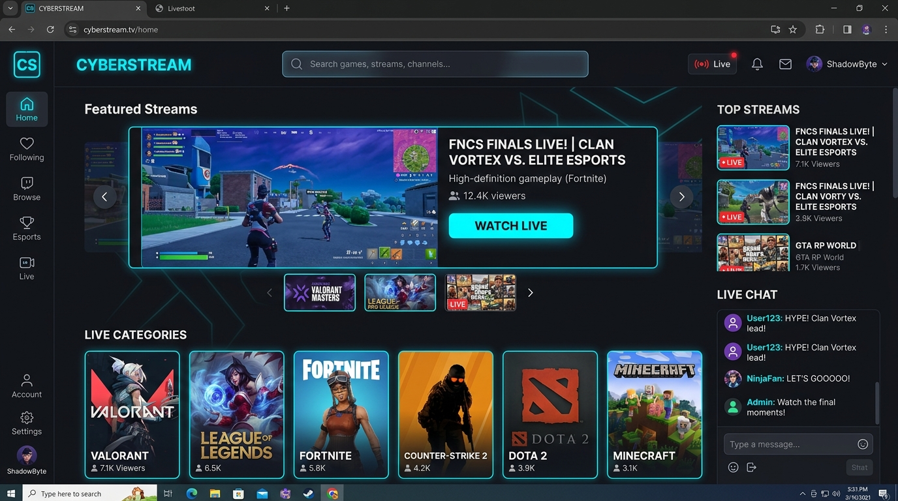
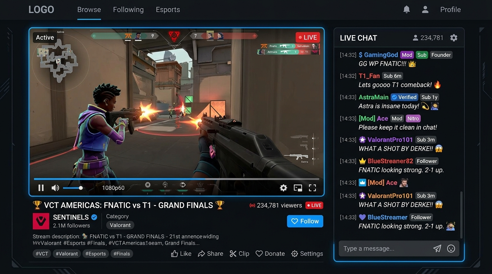
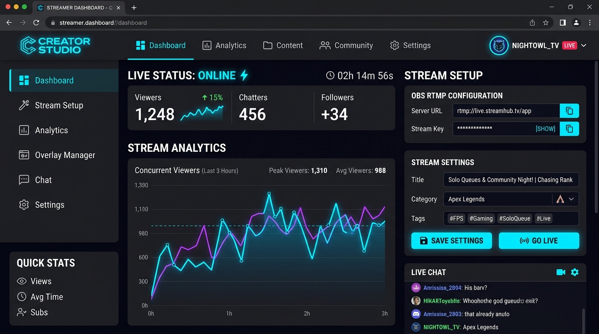

<div align="center">

# ⚡ AuraCast

**Nowoczesna Platforma Livestreamingowa Open-Source (Self-Hosted)**  
*Maksimum Wolności. Zero Prowizji. Stworzona dla Streamerów i Społeczności.*

[](https://www.gnu.org/licenses/agpl-3.0)
[](https://nodejs.org/)
[](https://www.typescriptlang.org/)
[](https://www.docker.com/)
[](https://react.dev/)
[](https://tailwindcss.com/)
[](https://socket.io/)

[🇬🇧 Read this documentation in English (README.md)](README.md)

</div>

---

## 🌟 O Projekcie

**AuraCast** to nowoczesna, wysoce wydajna platforma livestreamingowa typu open-source, zaprojektowana z myślą o pełnej suwerenności twórców nad ich transmisjami oraz zarobkami.

W przeciwieństwie do korporacyjnych monopoli, takich jak Twitch czy Kick, które pobierają od 30% do 50% prowizji z zarobków streamerów, narzucają arbitralną cenzurę i zamykają użytkowników w zamkniętych ekosystemach, AuraCast dostarcza w pełni samowystarczalny pakiet streamingowy klasy e-sportowej z bezpośrednią monetyzacją społecznościową (BYOM).

---

## 📸 Podgląd Interfejsu

| Strona Główna & Karuzela Transmisji | Odtwarzacz Na Żywo & Czat WebSockets |
| :---: | :---: |
|  |  |

<div align="center">

| Panel Twórcy (Stream Manager) & Konfiguracja OBS |
| :---: |
|  |

</div>

---

## ✨ Główne Atuty i Funkcje

- 🎥 **Niskie Opóźnienia RTMP (Zero-Lag):** Bezpośrednia integracja z OBS Studio, Streamlabs i vMix przez wbudowany serwer RTMP (port `1935`) oraz błyskawiczne odtwarzanie HTTP-FLV (port `8000`).
- 💬 **Czat na Żywo w Czasie Rzeczywistym (WebSockets):** Błyskawiczny czat oparty o pokoje Socket.io per kanał, z odznakami weryfikacji, hierarchią ról (Streamer, Mod, VIP), dynamicznymi kolorami nicków oraz popularnymi emotkami (`Kappa`, `LUL`, `PogChamp`, `KEKW`, `catJAM`, `monkaS`, `RushB`).
- 💸 **Model BYOM (Bring Your Own Monetization):** 0% prowizji platformy, brak wymuszonych abonamentów. Streamerzy umieszczają bezpośrednie odnośniki do Ko-fi, Patronite, Tiply czy portfeli krypto i zachowują 100% wsparcia od widzów.
- 🎨 **E-sportowy Design Electric Blue:** Dynamiczny, ciemny motyw gamingowy wykonany w Tailwind CSS v4, z półprzezroczystym glassmorphismem, customowymi kontrolkami wideo i zwijanym paskiem bocznym.
- 🛡️ **Pełna Niezależność (Self-Hosted):** Pełna kontrola nad bazą użytkowników, historią streamów i danymi serwera bez uzależnienia od zewnętrznych korporacji.

---

## 🏗️ Stack Technologiczny

- **Frontend:** React 19, TypeScript, Vite 8, Tailwind CSS v4, Socket.io Client, flv.js, Lucide Icons, Zustand.
- **Backend:** Node.js 20, Express, TypeScript (`tsx`), Socket.io Server, NodeMediaServer (RTMP / HTTP-FLV), MySQL2 (Connection Pool), JWT, bcrypt.
- **Baza Danych:** MySQL 8.0 z relacyjnym schematem i automatyczną migracją początkową.
- **Wdrożenie:** Docker & Docker Compose z wieloetapowymi obrazami i serwerem Nginx.

---

## 🚀 Szybki Start (Docker - Rekomendowany)

Najwygodniejszą metodą uruchomienia AuraCast lokalnie lub na serwerze produkcyjnym (VPS) jest Docker Compose:

### 1. Klonowanie repozytorium
```bash
git clone https://github.com/twoj-nick/AuraCast.git
cd AuraCast
```

### 2. Konfiguracja zmiennych środowiskowych
Skopiuj gotowy szablon `.env.example`:
```bash
cp .env.example .env
```

### 3. Uruchomienie za pomocą Dockera
```bash
docker compose up -d --build
```

Docker automatycznie:
1. Zainicjalizuje bazę **MySQL 8.0** wraz ze strukturą tabel (`database/schema.sql`).
2. Skompiluje i uruchomi **Backend API & Serwer RTMP** (porty `4000`, `1935`, `8000`).
3. Zbuduje i uruchomi zoptymalizowany **Frontend React** przez serwer Nginx (porty `80` i `5173`).

Aplikacja będzie natychmiast dostępna pod adresem: **http://localhost:5173** (lub adresem Twojego serwera).

---

## 💻 Ręczna Instalacja (Środowisko Developerskie)

Jeśli wolisz pracować bez Dockera:

### Wymagania wstępne
- **Node.js:** v20.0.0 lub nowszy
- **npm:** v10.0.0 lub nowszy
- **MySQL:** v8.0 działający lokalnie

### 1. Inicjalizacja Bazy Danych
```sql
CREATE DATABASE auracast;
USE auracast;
SOURCE database/schema.sql;
```

### 2. Uruchomienie Backendu
```bash
cd backend
cp .env.example .env
# Uzupełnij dane dostępowe do bazy w pliku .env
npm install
npm run dev
```
*API oraz WebSockets wystartują na `http://localhost:4000`, RTMP na porcie `1935`.*

### 3. Uruchomienie Frontendu
W nowym oknie terminala:
```bash
cd frontend
cp .env.example .env
npm install
npm run dev
```
*Aplikacja webowa otworzy się na `http://localhost:5173`.*

---

## 📡 Nadawanie z OBS Studio

1. Otwórz **OBS Studio** i wejdź w: `Ustawienia` → `Transmisja`.
2. Wybierz **Usługa:** `Własna...` (Custom).
3. W pole **Serwer** wklej: `rtmp://localhost/live` (lub `rtmp://IP_SERWERA/live`).
4. W pole **Klucz strumienia** wklej swoją nazwę użytkownika (np. `DevNinja`) lub prywatny klucz z **Panelu Twórcy** (`/dashboard`).
5. Kliknij **Rozpocznij transmisję**. Twój kanał natychmiast przejdzie w tryb **NA ŻYWO**!

---

## ⚙️ Tabela Zmiennych Środowiskowych

| Zmienna | Moduł | Wartość domyślna | Opis |
| :--- | :--- | :--- | :--- |
| `PORT` | Backend | `4000` | Port dla Express REST API & Socket.io |
| `NODE_ENV` | Backend | `production` | Tryb pracy (`development` / `production`) |
| `CORS_ORIGIN` | Backend | `*` | Dozwolona domena CORS (w produkcji domena frontendu) |
| `DB_HOST` | Backend | `db` (Docker) / `localhost` | Host bazy danych MySQL |
| `DB_PORT` | Backend | `3306` | Port bazy danych MySQL |
| `DB_USER` | Backend | `auracast_user` | Użytkownik bazy MySQL |
| `DB_PASSWORD` | Backend | - | Hasło do bazy MySQL |
| `DB_NAME` | Backend | `auracast` | Nazwa bazy danych |
| `JWT_SECRET` | Backend | - | Klucz szyfrujący tokeny autoryzacyjne JWT |
| `RTMP_PORT` | Backend | `1935` | Port odbioru streamu RTMP z OBS |
| `HTTP_MEDIA_PORT` | Backend | `8000` | Port strumieniowania HTTP-FLV dla odtwarzacza |
| `VITE_API_URL` | Frontend | `http://localhost:4000` | Adres URL backendu REST API |
| `VITE_MEDIA_URL` | Frontend | `http://localhost:8000` | Adres URL strumienia wideo HTTP-FLV |
| `VITE_WS_URL` | Frontend | `http://localhost:4000` | Adres URL czatu WebSockets |

---

## 🤝 Współtworzenie Projektu

Zapraszamy każdego do rozwijania AuraCast! Przed otwarciem Pull Requesta zapoznaj się z plikiem [CONTRIBUTING.md](CONTRIBUTING.md), gdzie opisano konwencję commitów (Conventional Commits), nazewnictwo branchy oraz procedurę testów.

---

## 📜 Licencja

Projekt dystrybuowany jest na licencji **GNU Affero General Public License v3.0 (AGPL-3.0)** - szczegóły w pliku [LICENSE](LICENSE).

W ramach AGPL-3.0:
- Masz pełną swobodę uruchamiania, badania, modyfikowania i redystrybucji kodu.
- Jeśli modyfikujesz AuraCast i udostępniasz go w sieci jako usługę (SaaS/sieciowo), **masz obowiązek udostępnić pełny kod źródłowy** modyfikacji wszystkim użytkownikom na tej samej licencji AGPL-3.0.
